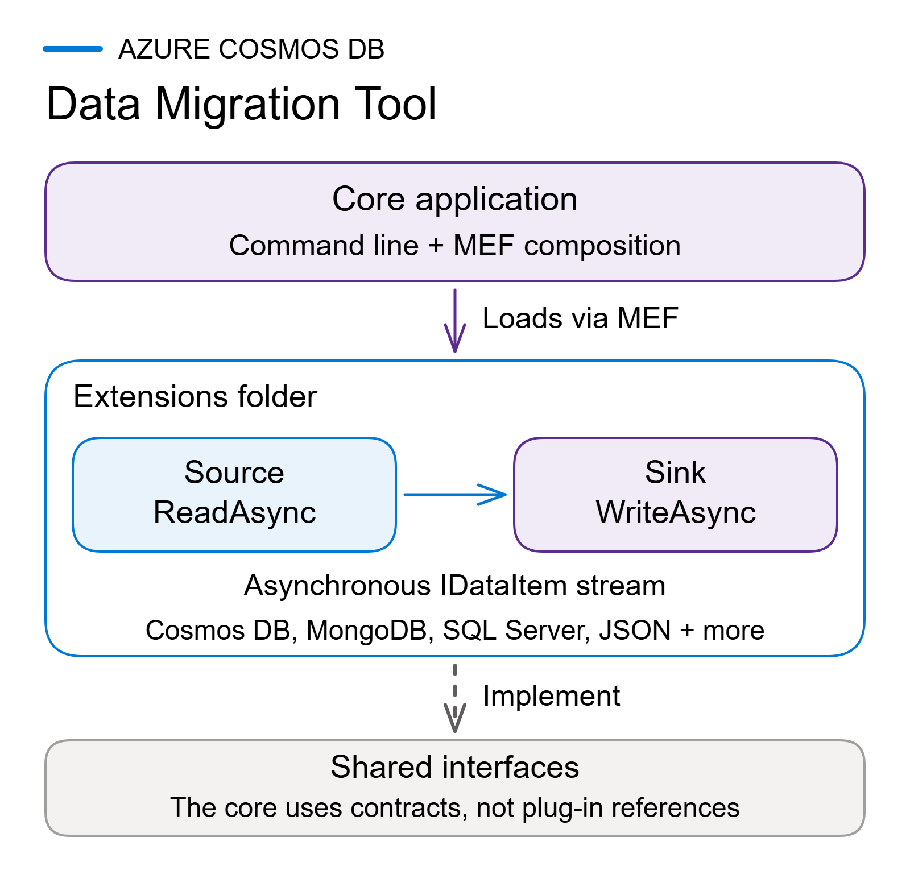
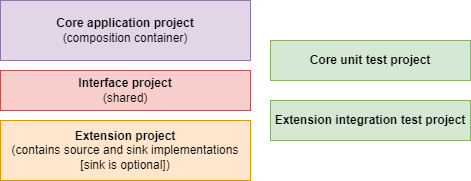
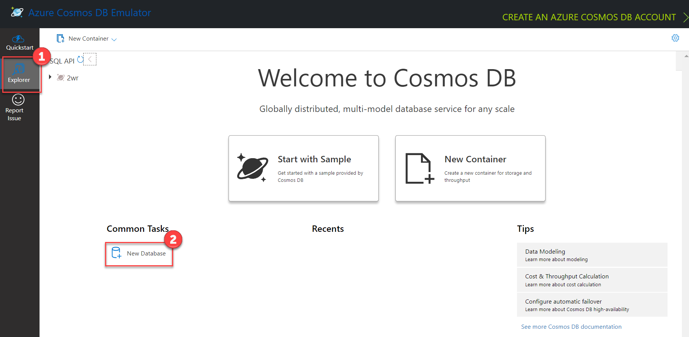
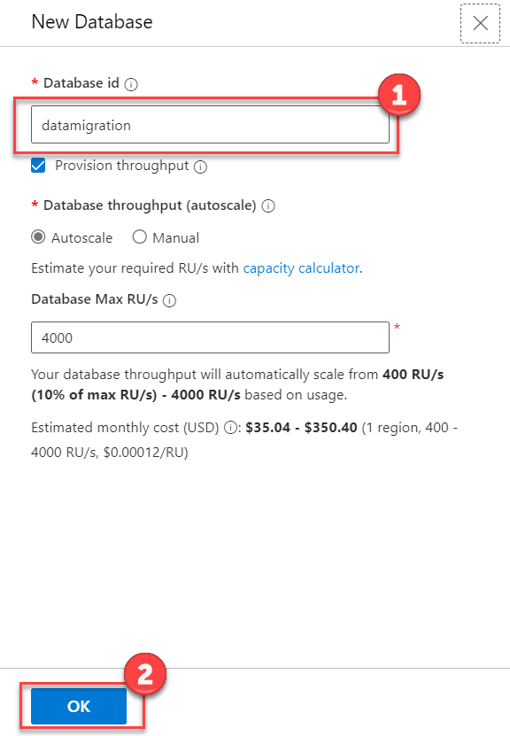
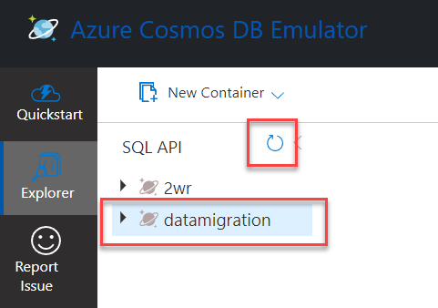
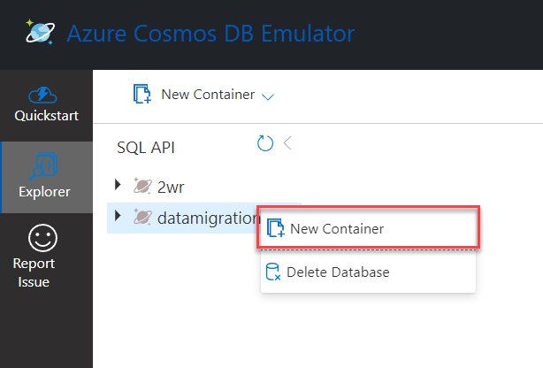
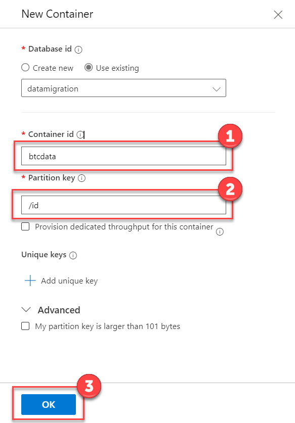
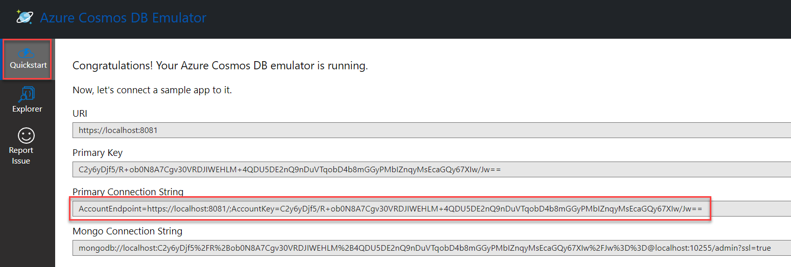

# Azure Cosmos DB Data Migration Tool

To access the archived version of the tool, navigate to the [**Archive branch**](https://github.com/Azure/azure-documentdb-datamigrationtool/tree/archive).

---

- [Azure Cosmos DB Data Migration Tool](#azure-cosmos-db-data-migration-tool)
  - [Overview](#overview)
  - [Quick Installation](#quick-installation)
  - [Extension documentation](#extension-documentation)
  - [Authentication](#authentication)
  - [Architecture](#architecture)
  - [Project Structure](#project-structure)
  - [Getting Started](#getting-started)
    - [Clone the source code repository](#clone-the-source-code-repository)
    - [Build the solution](#build-the-solution)
    - [Run from source](#run-from-source)
  - [Tutorial: JSON to Cosmos DB migration](#tutorial-json-to-cosmos-db-migration)
    - [Tutorial Software prerequisites](#tutorial-software-prerequisites)
    - [Task 1: Prepare the Cosmos DB destination](#task-1-prepare-the-cosmos-db-destination)
    - [Task 2: Prepare JSON source documents](#task-2-prepare-json-source-documents)
    - [Task 3: Setup the data migration configuration](#task-3-setup-the-data-migration-configuration)
    - [Task 4: Run and verify the migration](#task-4-run-and-verify-the-migration)
  - [Using the command line](#using-the-command-line)
  - [Creating Extensions](#creating-extensions)

## Overview

The Azure Cosmos DB Desktop Data Migration Tool is an open-source project containing a command-line application that provides import and export functionality for Azure Cosmos DB.

**Key Features:**
- Support for multiple data sources and sinks including Cosmos DB, MongoDB, JSON, CSV, SQL Server, and more
- Write to multiple different Cosmos DB accounts in one run using sequential Operations
- Batch processing and bulk execution for optimal performance
- Flexible authentication options including connection strings and RBAC
- Independent client configurations for each sink operation

## Quick Installation

**To use a release, you do not need Visual Studio or the .NET SDK/runtime
installed.** The release archives are self-contained. Download the archive for
your operating system and processor from the
[latest release](https://github.com/AzureCosmosDB/data-migration-desktop-tool/releases/latest),
not the **Source code** archives.

The source on this branch targets **.NET 10 LTS**. Existing releases and images
do not change when the source is upgraded: installing .NET 10 on your computer
does **not** update a self-contained DMT download or container. Use a release
explicitly identified as .NET 10-based when it becomes available, and replace
the entire installation, including `Extensions`. See
[runtime support and servicing](docs/runtime-support.md) for platform requirements
and custom-extension compatibility.

|Platform|Archive name|
|---|---|
|macOS, Apple Silicon (M-series)|`dmt-<version>-mac-arm64.zip`|
|macOS, Intel|`dmt-<version>-mac-x64.zip`|
|Windows|`dmt-<version>-win-x64.zip` or `dmt-<version>-win-arm64.zip`|
|Linux|`dmt-<version>-linux-x64.tar.gz` or `dmt-<version>-linux-arm64.tar.gz`|

On macOS, check **Apple menu > About This Mac**: **Chip** identifies Apple
Silicon, while **Processor** identifies an Intel Mac. Extract **all** files to
your chosen install folder, keeping `dmt`, the configuration files, and
`Extensions` together.

Open Terminal on macOS/Linux, change to the extracted folder (replace the
example path below), and list the available extensions:

```bash
cd "$HOME/Downloads/dmt"
./dmt list
```

On Windows, open PowerShell in the extracted folder and run `.\dmt.exe list`. If
macOS/Linux reports **Permission denied**, run `chmod u+x ./dmt` in that folder
and retry. If macOS blocks the downloaded application, follow
[Apple's instructions for opening an app from an unidentified developer](https://support.apple.com/guide/mac-help/open-a-mac-app-from-an-unidentified-developer-mh40616/mac)
only after verifying that you downloaded it from this repository's releases. Do
not disable Gatekeeper globally.

To begin a transfer, configure `migrationsettings.json` for your source and
sink, then follow [Using the command line](#using-the-command-line) or the
[JSON tutorial](#tutorial-json-to-cosmos-db-migration). To modify or debug the
tool instead, follow [Getting Started](#getting-started) to build the source.

## Docker Container

You can also run the Data Migration Tool as a Docker container, which is useful for CI/CD pipelines or environments where installing the tool directly isn't preferred.

### Using Pre-built Docker Image

The easiest way to use the container is to pull the pre-built image from Microsoft Container Registry. You can pull a specific version starting with version `3.0.0` and greater or use the `latest` tag to pull the latest version of the container from the registry.  

**Example using a specific version:**

```bash
docker pull mcr.microsoft.com/azurecosmosdb/linux/azure-cosmos-dmt:3.0.0
docker run -v $(pwd)/config:/config -v $(pwd)/data:/data mcr.microsoft.com/azurecosmosdb/linux/azure-cosmos-dmt:3.0.0 run --settings /config/migrationsettings.json
```

**Example using latest version:**

```bash
docker pull mcr.microsoft.com/azurecosmosdb/linux/azure-cosmos-dmt:latest
docker run -v $(pwd)/config:/config -v $(pwd)/data:/data mcr.microsoft.com/azurecosmosdb/linux/azure-cosmos-dmt:latest run --settings /config/migrationsettings.json
```

### Building the Docker Image Locally

To build the Docker image locally:

```bash
docker build -t data-migration-tool .
```

The Dockerfile pins the .NET 10 SDK and runtime-dependencies images to Ubuntu
24.04 (`noble`), with ICU, OpenSSL and CA certificates. Its default target is
`linux-x64`. For a **native ARM64 Linux** Docker host, use
`docker build --build-arg RUNTIME=linux-arm64 -t data-migration-tool .`.
Do not treat an emulated build or a successful image build as native execution
validation. No credentials or Azure CLI installation are needed for
`docker run --rm data-migration-tool list`.

### Running the Container

Run the container with your configuration files mounted:

```bash
docker run -v $(pwd)/config:/config -v $(pwd)/data:/data data-migration-tool run --settings /config/migrationsettings.json
```

Where:

- `/config` contains your configuration files including `migrationsettings.json`
- `/data` is the directory for your data files

You can also mount custom extensions:

```bash
docker run -v $(pwd)/config:/config -v $(pwd)/data:/data -v $(pwd)/extensions:/extensions data-migration-tool run --source customsource --sink customsink --settings /config/migrationsettings.json
```

### Docker Compose Example

A `docker-compose.yml` file is provided as an example:

```bash
docker-compose up
```

This will build the image and run the container with the mounted volumes. You can modify the `docker-compose.yml` file to customize the command and volumes.

### Special Extensions

- **MongoDB with Wire Version 2**: For older MongoDB instances (like Azure Cosmos DB for MongoDB API using `documents.azure.com` endpoint), use the **MongoDB-Legacy (Wire v2)** extension. See [MongoDB Legacy Extension documentation](Extensions/Mongo/README.md#mongodb-legacy-extension-wire-version-2) for details.

If using RBAC (Role Based Access Control) [migrate-passwordless](https://learn.microsoft.com/azure/cosmos-db/nosql/migrate-passwordless?tabs=sign-in-azure-cli%2Cdotnet%2Cazure-portal-create%2Cazure-portal-associate%2Capp-service-identity) ensure you are authenticated with Azure see [Troubleshoot Azure Identity authentication issues](https://github.com/Azure/azure-sdk-for-net/blob/main/sdk/identity/Azure.Identity/TROUBLESHOOTING.md) One common way to authenticate is using the Azure CLI [How to install the Azure CLI](https://learn.microsoft.com/cli/azure/install-azure-cli) and `az login`
## Extension documentation

Multiple extensions are provided in this repository. Find the documentation for the usage and configuration of each using the links provided:

1. [Azure Cosmos DB](Extensions/Cosmos/README.md)

1. [Azure Table API](Extensions/AzureTableAPI/README.md)

1. [JSON](Extensions/Json/README.md)

1. [MongoDB](Extensions/Mongo/README.md)

1. [SQL Server](Extensions/SqlServer/README.md)

1. [Parquet](Extensions/Parquet/README.md)

1. [CSV](Extensions/Csv/README.md)

1. [File Storage](Interfaces/Cosmos.DataTransfer.Common/README.md)

1. [Azure Blob Storage](Extensions/AzureBlob/README.md)

1. [AWS S3](Extensions/AwsS3/README.md)

1. [Azure Cognitive Search](Extensions/CognitiveSearch/README.md)

## Authentication

The Cosmos, Azure Blob, and Azure Table API extensions support both key-based authentication and passwordless authentication using **Microsoft Entra ID** (Azure AD) with **Azure RBAC**. The CognitiveSearch extension uses API keys only. For supported credential flows (Azure CLI, managed identity, service principal), required roles, end-to-end passwordless examples, and CI/CD guidance, see the [Authentication guide](docs/authentication.md).

## Architecture

The Azure Cosmos DB Data Migration Tool is a lightweight executable that leverages the [Managed Extensibility Framework (MEF)](https://docs.microsoft.com/en-us/dotnet/framework/mef/). MEF enables decoupled implementation of the core project and its extensions. The core application is a command-line executable responsible for composing the required extensions at runtime by automatically loading them from the Extensions folder of the application. An Extension is a class library that includes the implementation of a System as a Source and (optionally) Sink for data transfer. The core application project does not contain direct references to any extension implementation. Instead, these projects share a common interface.



[Edit the architecture diagram](media/application_architecture.excalidraw).

## Project Structure

The Cosmos DB Data Migration Tool core project is a C# command-line executable. The core application serves as the composition container for the required Source and Sink extensions. Therefore, the application user needs to put only the desired Extension class library assembly into the Extensions folder before running the application. In addition, the core project has a unit test project to exercise the application's behavior, whereas extension projects contain concrete integration tests that rely on external systems.



This project has adopted the [Microsoft Open Source Code of Conduct](https://opensource.microsoft.com/codeofconduct/). For more information see the [Code of Conduct FAQ](https://opensource.microsoft.com/codeofconduct/faq/) or contact [opencode@microsoft.com](mailto:opencode@microsoft.com) with any additional questions or comments.

## Getting Started

This section is for **building from source** on macOS, Windows, or Linux. If you
only want to run a migration, use [Quick Installation](#quick-installation)
instead.

Install [Git](https://git-scm.com/downloads) and the
[.NET 10 SDK](https://dotnet.microsoft.com/download/dotnet/10.0) for your
operating system and processor (Arm64 for Apple Silicon, x64 for Intel Macs). An
IDE is optional; the commands below work in Terminal on macOS/Linux and
PowerShell on Windows.

Install the exact stable SDK in [`global.json`](global.json) (currently
**10.0.403**). SDK roll-forward and preview selection are disabled, so local
builds, CI and containers use the same compiler. `Directory.Build.props` pins the
bundled runtime to **10.0.14**. An SDK-selection error means that the pinned SDK
must be installed; do not remove `global.json` to bypass it.

### Clone the source code repository

From a folder where you keep source code, clone the repository and enter its
root:

```shell
git clone https://github.com/AzureCosmosDB/data-migration-desktop-tool.git
cd data-migration-desktop-tool
```

### Build the solution

Run these commands from the repository root:

```shell
dotnet --list-sdks
dotnet build CosmosDbDataMigrationTool.sln --configuration Debug
```

The build restores NuGet dependencies and builds both the **Core** application
and the extension projects. Use the full solution and **Debug** configuration:
the extension projects publish their assemblies and dependencies into
`Core/Cosmos.DataTransfer.Core/bin/Debug/net10.0/Extensions`. Building only the
Core project does not build the extensions. Keep that folder alongside the Core
output.

On Windows, you can alternatively open `CosmosDbDataMigrationTool.sln` in Visual
Studio with support for the pinned .NET 10 SDK (Visual Studio 2026 or later) and
build the solution in Debug with <kbd>Ctrl</kbd>+<kbd>Shift</kbd>+<kbd>B</kbd>.
[Visual Studio for Mac is retired](https://learn.microsoft.com/lifecycle/announcements/visual-studio-mac-end-of-servicing);
use the CLI above or an editor such as Visual Studio Code on macOS. This
repository does not include a VS Code build task, so <kbd>Cmd</kbd>+<kbd>Shift</kbd>+<kbd>B</kbd> alone is not
a build setup.

### Run from source

After the solution build, run this from the repository root to confirm extension
discovery:

```shell
dotnet run --project Core/Cosmos.DataTransfer.Core --configuration Debug \
  --no-build --no-launch-profile -- list
```

In Windows PowerShell, replace the trailing `\` with a backtick (`` ` ``)
for line continuation, or enter the command on one line.

The list should include `JSON` and `Cosmos-nosql`. `--no-launch-profile` avoids
applying the IDE's sample launch profiles.

Create your own `migrationsettings.json` in the repository root using the
[tutorial](#task-3-setup-the-data-migration-configuration), then run:

**macOS/Linux (Terminal):**

```bash
dotnet run --project Core/Cosmos.DataTransfer.Core --configuration Debug \
  --no-build --no-launch-profile -- \
  run --settings "$PWD/migrationsettings.json"
```

**Windows (PowerShell):**

```powershell
dotnet run --project Core\Cosmos.DataTransfer.Core --configuration Debug `
  --no-build --no-launch-profile -- `
  run --settings (Join-Path $PWD "migrationsettings.json")
```

The `--` separates .NET CLI options from DMT options. Using an explicit settings
path avoids depending on the working directory selected by `dotnet run`.
Application configuration and the default `Extensions` folder are loaded beside
the built executable, not beside your migration settings file.

## Tutorial: JSON to Cosmos DB migration

This tutorial moves a sample JSON document to Azure Cosmos DB for NoSQL. You can
use a downloaded release or a source build on macOS, Windows, or Linux.

### Tutorial Software prerequisites

1. DMT installed from a [release](#quick-installation) or
   [built from source](#build-the-solution). Only source builds require the .NET
   SDK.
2. A text editor for the JSON configuration and a terminal to run DMT.
3. A test Azure Cosmos DB for NoSQL account, or an emulator appropriate for your
   platform as described below. Use sample data and a dedicated test container,
   not a production destination.

### Task 1: Prepare the Cosmos DB destination

Choose **one** of the following destinations.

#### Azure account (all platforms, including macOS)

1. Use a test Azure Cosmos DB for NoSQL account, or follow the
   [Azure portal quickstart](https://learn.microsoft.com/azure/cosmos-db/quickstart-portal)
   to create one. An Azure subscription is required and charges can apply.
2. In the account's **Data Explorer**, select **New Container**. Create database
   `datamigration`, container `btcdata`, and partition key `/id`. Review the
   throughput and cost settings before creating it.
3. For this connection-string example, copy the account's **Primary Connection
   String** from **Keys** in the Azure portal. Keep it private and do not commit
   it to source control. If your account requires Microsoft Entra ID instead of
   keys, use the [Authentication guide](docs/authentication.md); keep the
   database and container pre-created and use its RBAC sink settings in Task 3.

#### Docker emulator (macOS/Linux)

There is no native Windows emulator application to launch on macOS. For local
development, follow the official
[Linux vNext emulator setup and requirements](https://learn.microsoft.com/azure/cosmos-db/emulator-linux)
with Docker on your Mac, including Intel and Apple Silicon. This emulator is a
preview with limited feature support; the Azure-account route above avoids those
limitations.

DMT uses the Cosmos DB .NET client, so enable **HTTPS** (`--protocol https` or
`PROTOCOL=https`), configure trust for the emulator's certificate on the host,
and retain TLS certificate validation. Use the emulator's HTTPS endpoint and
documented emulator key in your connection string. Keep `ConnectionMode` set to
`Gateway` and `AllowBulkExecution` set to `false` as in the example below; the
repository's emulator tests use these settings for .NET compatibility. The API
uses port `8081`, Data Explorer uses port `1234` (with the configured protocol),
and the readiness probe is `http://localhost:8080/ready`. Create `datamigration`
/ `btcdata` with partition key `/id` in that Data Explorer.

The preview emulator does not enforce authentication. Keep its ports local to
your machine and use it only for trusted development/test data. Do not use the
Windows-only Explorer URL or screenshots below for this emulator. If local
HTTPS/certificate setup is unavailable, use an Azure account rather than
disabling certificate validation.

#### Windows emulator

Install the
[Windows Azure Cosmos DB emulator](https://learn.microsoft.com/azure/cosmos-db/local-emulator)
before following these Windows-only steps.

1. Launch the Azure Cosmos DB emulator application and open <https://localhost:8081/_explorer/index.html> in a browser.

2. Select the **Explorer** option from the left menu. Then choose the **New Database** link found beneath the **Common Tasks** heading.

    

3. On the **New Database** blade, enter `datamigration` in the **Database id** field, then select **OK**.

    

4. If the **datamigration** database doesn't appear in the list of databases, select the **Refresh** icon.

    

5. Expand the ellipsis menu next to the **datamigration** database and select **New Container**.

   

6. On the **New Container** blade, enter `btcdata` in the **Container id** field, and `/id` in the **Partition key** field.  Select the **OK** button.

    

   > **Note**: With key-based authentication, DMT can create a missing database
   > and container using the sink settings. With RBAC authentication, they must
   > already exist. This tutorial creates them explicitly for either route.

### Task 2: Prepare JSON source documents

Download [resources/sample-data.zip](resources/sample-data.zip) from this
repository (on GitHub, use **Download raw file**), or use that file in your
source checkout. The release binary archive does not include it.

**macOS/Linux:** extract it into a working folder. If you cloned the repository,
run the following from its root:

```bash
mkdir -p "$HOME/btcdata"
unzip resources/sample-data.zip -d "$HOME/btcdata"
```

If you downloaded only the sample ZIP, replace `resources/sample-data.zip` with
its downloaded path, for example `"$HOME/Downloads/sample-data.zip"`.

**Windows (PowerShell):** from the repository root, run:

```powershell
Expand-Archive -Path .\resources\sample-data.zip -DestinationPath "$HOME\btcdata"
```

Alternatively, extract the downloaded ZIP in File Explorer. The archive contains
a **sample-data** subfolder. For this tutorial, use
`sample-data/data_20090110.json` inside the extracted folder. For example, on
macOS the full path is
`/Users/<your-user>/btcdata/sample-data/data_20090110.json`; on Windows it is
`C:\Users\<your-user>\btcdata\sample-data\data_20090110.json`. There is no
`simple_json.json` in this archive.

### Task 3: Setup the data migration configuration

1. Each extension contains a README document that outlines configuration for the data migration. In this case, locate the configuration for [JSON (Source)](Extensions/Json/README.md) and [Cosmos DB (Sink)](Extensions/Cosmos/README.md).

2. In your text editor, create `migrationsettings.json` in the extracted DMT
   folder (release) or repository root (source build). Paste the example below,
   replacing `<your-user>`, `<your-account>`, and `<your-key>` with your actual
   values. Set **FilePath** to the absolute path of the extracted sample. For
   Windows, use escaped backslashes, for example
   `"C:\\Users\\<your-user>\\btcdata\\sample-data\\data_20090110.json"`; for
   Linux, use your actual home path, for example
   `/home/<your-user>/btcdata/sample-data/data_20090110.json`. JSON does not
   expand `~`, `$HOME`, or other shell variables.

   Use the connection string from your chosen destination. For the Windows
   emulator, find **Primary Connection String** on its **Quickstart** screen.
   For the Docker emulator, use its HTTPS endpoint and key, not the
   Azure-account placeholders below. Save the settings file locally and keep
   credentials out of source control.

    >**Note**: The alternate terms *Target* and *Destination* can be used in place of *Sink* in configuration files and command line parameters. For example `"Target"` and `"TargetSettings"` would also be valid in the below example.

    ```json
    {
        "Source": "JSON",
        "Sink": "Cosmos-nosql",
        "SourceSettings": {
            "FilePath": "/Users/<your-user>/btcdata/sample-data/data_20090110.json"
        },
        "SinkSettings": {
            "ConnectionString": "AccountEndpoint=https://<your-account>.documents.azure.com:443/;AccountKey=<your-key>;",
            "Database": "datamigration",
            "Container": "btcdata",
            "PartitionKeyPath": "/id",
            "RecreateContainer": false,
            "ConnectionMode": "Gateway",
            "AllowBulkExecution": false
        }
    }
    ```

   

### Task 4: Run and verify the migration

For a **release**, open a terminal in the extracted DMT folder containing your
settings file:

**macOS/Linux:**

```bash
./dmt run --settings "$PWD/migrationsettings.json"
```

**Windows (PowerShell):**

```powershell
.\dmt.exe run --settings (Join-Path $PWD "migrationsettings.json")
```

For a **source build**, use the corresponding
[Run from source](#run-from-source) command from the repository root.

Wait for **Data transfer complete**. If the tool reports **Data transfer
failed**, inspect the error and check the source path, connection settings,
permissions, and (for an emulator) HTTPS/certificate setup. In your
destination's Data Explorer, refresh `datamigration` > `btcdata` > **Items** and
confirm the sample with `Ticker` equal to `BTC` and `Date` equal to
`2009-01-10T23:59:00Z` is present. DMT supplies an `id` when the source document
has none; repeating this sample migration can therefore add another item.

If you created Azure resources just for this tutorial, remove only those test
resources when finished to avoid ongoing charges.

>**Note**: The `Source` and `Sink` properties should match the **DisplayName** set in the code for the extensions.

## Using the command line

1. Download the
   [latest release](https://github.com/AzureCosmosDB/data-migration-desktop-tool/releases/latest)
   using [Quick Installation](#quick-installation), or follow
   [Run from source](#run-from-source) for the .NET CLI equivalent of the
   commands below.

2. Keep the **Extensions** folder and its dependencies beside the executable.
   Run `./dmt list` on macOS/Linux or `.\dmt.exe list` on Windows to see the
   [plug-ins available](#extension-documentation).

3. Update **migrationsettings.json** as documented in the
   [tutorial](#task-3-setup-the-data-migration-configuration),
   [Extension documentation](#extension-documentation), or
   [example configurations](ExampleConfigs.md). Use absolute file paths to avoid
   confusion about the working directory.

> **Note**: **migrationsettings.json** can also be configured to execute multiple data transfer operations with a single run command. To do this, include an `Operations` property consisting of an array of objects that include `SourceSettings` and `SinkSettings` properties using the same format as those shown above for single operations. Additional details and examples can be found in [this blog post](https://codemindinterface.com/2023/03/cosmos-tool-operations/).

4. From the extracted DMT folder, execute the program using the appropriate
   command:

   **Using Windows (PowerShell)**

   ```powershell
   .\dmt.exe run --settings (Join-Path $PWD "migrationsettings.json")
   ```

   **Using macOS/Linux**

    ```bash
    ./dmt run --settings "$PWD/migrationsettings.json"
    ```

   > **Note**: `--settings` accepts a path to a different settings file. With
   > the default application configuration, omitting it uses
   > **migrationsettings.json** relative to the process's current working
   > directory, not necessarily the executable's folder. Quote paths containing
   > spaces. For macOS first-run permissions and trust guidance, see
   > [Quick Installation](#quick-installation).

## Creating Extensions

1. Decide what type of extension you want to create. There are 3 different types of extensions and each of those can be implemented to read data, write data, or both.
    
    1. DataSource/DataSink extension: Appropriate for data sources which include both a native data format and storage. Most databases fall under this category and generally your extension will be written using an SDK specific to that type of database. For example, SQL Server uses data structured as tables and is accessed through drivers that handle underlying communication with the database.
    1. Binary File Storage extension: Only concerned with the storage of binary files and is agnostic to the specific file format. Examples include files on local disk or cloud blob storage providers. This type of extension can be used by any File Format extension.
    1. File Format extension: Handles translating data for a specific binary file format but is agnostic to storage. Examples include JSON or Parquet. This type of extension can be combined with any Binary File Storage extension to create multiple DataSource/DataSink extensions. 

1. Add a new folder in the Extensions folder with the name of your extension.

2. Create the extension project and an accompanying test project.
    - The naming convention for extension projects is `Cosmos.DataTransfer.<Name>Extension`.
    - Extension projects should target `net10.0` and use the **Console Application** type, following the existing projects and central package versions. Include a Program.cs file so the project can publish its dependencies.
    > Binary File Storage extensions are only used in combination with other extensions so should be placed in a .NET 10 **Class Library** without the additional debugging configuration needed below.

    Rebuild custom extensions against this release's shared interfaces/common
    assemblies, and test discovery and actual transfers with the published DMT
    executable on each intended platform. Older `net8.0` binaries are not
    categorically unloadable, but binary, dependency and behavioral compatibility
    is not guaranteed. Do not copy old shared/runtime assemblies over the new
    distribution. See [extension compatibility](docs/runtime-support.md#extensions).
  
3. Add the new projects to the `CosmosDbDataMigrationTool` solution.

4. In order to facilitate local debugging the extension build output along with any dependencies needs to be copied into the `Core\Cosmos.DataTransfer.Core\bin\Debug\net10.0\Extensions` folder. To set up the project to automatically copy add the following changes.
    - Add a Publish Profile to Folder named `LocalDebugFolder` with a Target Location of `..\..\..\Core\Cosmos.DataTransfer.Core\bin\Debug\net10.0\Extensions`
    - To publish every time the project builds, edit the .csproj file to add a new post-build step:

    ```xml
    <Target Name="PublishDebug" AfterTargets="Build" Condition=" '$(Configuration)' == 'Debug' ">
       <Exec Command="dotnet publish --no-build -p:PublishProfile=LocalDebugFolder" />
    </Target>
    ```

5. Add references to the `System.ComponentModel.Composition` NuGet package and the `Cosmos.DataTransfer.Interfaces` project.

6. Extensions can implement either `IDataSourceExtension` to read data or `IDataSinkExtension` to write data. Classes implementing these interfaces should include a class level `System.ComponentModel.Composition.ExportAttribute` with the implemented interface type as a parameter. This will allow the plugin to get picked up by the main application.
    - Binary File Storage extensions implement the `IComposableDataSource` or `IComposableDataSink` interfaces. To be used with different file formats, the projects containing the formatters should reference the extension's project and add new `CompositeSourceExtension` or `CompositeSinkExtension` referencing the storage and formatter extensions.
    - File Format extensions implement the `IFormattedDataReader` or `IFormattedDataWriter` interfaces. In order to be usable each should also declare one or more `CompositeSourceExtension` or `CompositeSinkExtension` to define available storage locations for the format. This will require adding references to Storage extension projects and adding a declaration for each file format/storage combination. Example:
        ```csharp
        [Export(typeof(IDataSinkExtension))]
        public class JsonAzureBlobSink : CompositeSinkExtension<AzureBlobDataSink, JsonFormatWriter>
        {
            public override string DisplayName => "JSON-AzureBlob";
        }
        ```
    7. Settings needed by the extension can be retrieved from any standard .NET configuration source in the main application by using the `IConfiguration` instance passed into the `ReadAsync` and `WriteAsync` methods. Settings under `SourceSettings`/`SinkSettings` will be included as well as any settings included in JSON files specified by the `SourceSettingsPath`/`SinkSettingsPath`.

8. Implement your extension to read and/or write using the generic `IDataItem` interface which exposes object properties as a list key-value pairs. Depending on the specific structure of the data storage type being implemented, you can choose to support nested objects and arrays or only flat top-level properties.
    > Binary File Storage extensions are only concerned with generic storage so only work with `Stream` instances representing whole files rather than individual `IDataItem`. 
